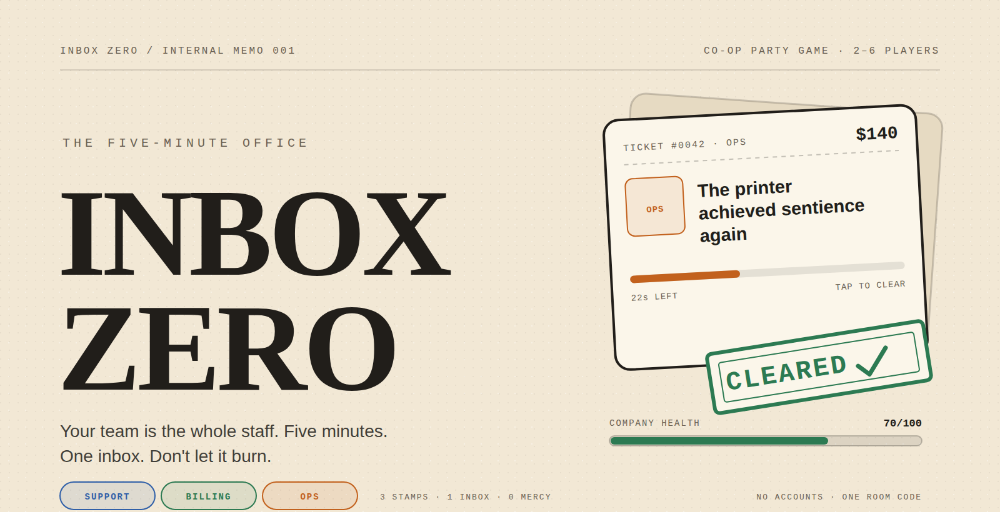

<p align="center">
  
</p>

<p align="center">
  
  
  
  
</p>

<h1 align="center">INBOX ZERO</h1>
<p align="center"><strong>The Five-Minute Office</strong></p>
<p align="center"><em>Your team is the whole staff. Five minutes. One inbox. Don't let it burn.</em></p>

<p align="center"><strong><a href="https://vyva360-byte.github.io/inbox-zero-office/">▶ Play the hosted build</a></strong> — open it, create a room, share the four-letter code.</p>

A cooperative multiplayer party game for **2–6 players** that runs in a browser tab. A tiny company's inbox floods with absurd work tickets, and you and your coworkers are the entire staff. Clear what your stamp owns, route the rest to the person who can actually fix it, and keep the company alive until 0:00.

No accounts. No installs. One four-letter room code.

Some of the tickets you'll meet:

> 💬 _"The captcha says I'm a robot and honestly, fair."_
>
> 💳 _"Client paid in 'exposure.' We need rent."_
>
> ⚙️ _"The printer achieved sentience again."_

---

## Why it's fun

- **Everyone sees the same inbox.** No private queues, no hiding. The newest ticket lands on top for the whole staff at once.
- **Your stamp is your job.** Support, Billing, Ops. You can only clear what you own, so you spend half the shift shouting across the room.
- **Routing is the team move.** Tap someone else's ticket to route it: +5 seconds on the timer and a cushion for whoever can actually clear it.
- **One ticket at a time.** Clearing takes 2.5 seconds and pins the ticket to the bottom of your screen. Pick the wrong moment and the inbox keeps flooding.
- **The clock escalates.** Spawns speed up and timers shrink across four phases. The last minute is called FIRE DRILL for a reason.
- **It can always end badly.** Every dropped ticket cuts Company Health. Hit zero and the company folds on the spot. Survive and you get a letter grade — and if you limp over the line under 25 health, the title **CHAOS GREMLINS**.

## How to play

1. **Open a room.** One player creates a room and shares the four-letter code. Everyone else joins from their own phone or laptop with a display name. No accounts — your browser remembers you.
2. **Get a stamp.** Stamps are dealt automatically so all three types are covered: with two players it's a 2 + 1 split, with three or more everyone gets one and extras duplicate. The host can re-roll, then presses **Start Shift**.
3. **Clear your tickets.** Tap a ticket with your stamp. It moves to your desk, processes for 2.5 seconds with a progress ring, then pays out its value as Revenue and a little Company Health. One ticket at a time.
4. **Route everything else.** Tap a ticket that isn't your stamp to route it: its timer gains +5 seconds. Each ticket can be routed once every 10 seconds, and its owner has to do the actual clearing.
5. **Survive.** A ticket whose timer hits zero drops and costs 4–8 Company Health. Health at 0 ends the shift immediately. Survive to 0:00 and the report grades you from **S** (90+) to **D** (under 40).

| Stamp | What you're clearing |
| :-- | :-- |
| 💬 **Support** | Password crises, upside-down screens, captchas with trust issues |
| 💳 **Billing** | Double charges, $0.00 invoices for $900, clients paying in exposure |
| ⚙️ **Ops** | Sentient printers, fish in the server room, the plant's recurring meeting |

### The five minutes

| Phase | Clock | New ticket every | Ticket timer |
| :-- | :-- | :-- | :-- |
| Morning Calm | 5:00 → 4:00 | 5s | 35s |
| Getting Busy | 4:00 → 2:00 | 3.5s | 30s |
| Rush Hour | 2:00 → 1:00 | 2.5s | 25s |
| FIRE DRILL | 1:00 → 0:00 | 2s | 20s |

Company Health starts at **70**. Clearing a ticket adds **+2 to +5** (scaled by value); a dropped ticket takes **−4 to −8**.

## Quick start

Requirements: Node 20+ (or Bun). From the project root:

```bash
# 1. install
npm install

# 2. terminal one — Convex backend + generated types
#    first run: log in and create a dev deployment; it writes VITE_CONVEX_URL to .env.local
npx convex dev

# 3. terminal two — the app
npm run dev
```

Open **http://localhost:5173**. There are no API keys or database setup beyond the Convex deployment.

**Testing multiplayer on one machine:** two normal tabs share the same local identity, so they count as one player. Use a normal window plus an incognito window — separate storage means separate staffers. Create in one, join with the code in the other.

### Deploying

The game is a static Vite client plus a Convex backend:

```bash
npx convex deploy   # create/push the production backend
npm run build       # static client in dist/
```

Host `dist/` on any static host with an SPA fallback (deep links like `/room/ABCD` must serve `index.html`). `VITE_CONVEX_URL` has to be present when the client is built.

**Hosted demo note:** the GitHub Pages build of this repo is published without a connected Convex deployment, so the front desk loads but room creation can't complete there. To run the full game from the hosted client, deploy the backend (`npx convex deploy`) and rebuild with `VITE_CONVEX_URL` set to your deployment URL — or just run it locally with the quick start above.

### Checks

```bash
npm run typecheck   # tsc -b --noEmit
npm run lint        # eslint
```

The generated Convex bindings in `src/convex/_generated/` are committed, so checks work without a live deployment — rerun `npx convex dev` after changing the schema or functions.

## How it works

The whole shift is **one document per room** in Convex: room code, players and stamps, claims, routes, a random seed, and the start/end timestamps.

- **The clock is simulated, not stepped.** [`src/convex/gameEngine.ts`](src/convex/gameEngine.ts) is a pure function of the room inputs evaluated at `now`. It rebuilds the spawn schedule deterministically from the seed, applies processing completions and expiries, and folds health, revenue, counts, phase and grade into one snapshot. There is no cron, no background worker, and no per-second writes. A room nobody looked at for ten seconds catches up on the next read.
- **Claims are conditional mutations.** `claimTicket` re-simulates, verifies the ticket is still open, the player holds the stamp and their desk is empty, then records the claim. If two people tap the same ticket, one wins and the other gets a `taken` response and a shake.
- **Every timer is a server timestamp.** The client re-reads the room about once a second and runs a 200ms local clock for smooth bars, so all screens agree on the deadline and the 5:00 clock.

```ts
rooms {
  code, seed, hostId,
  players: [{ id, name, stamps }],
  claims:  [{ ticketId, playerId, at }],
  routes:  [{ ticketId, playerId, at }],
  dealOffset, startAt, endsAt
}
```

### Project layout

```
src/
├── pages/
│   ├── Landing.tsx          front desk — create or join
│   └── Room.tsx             join → lobby → live shift → report
├── components/game/         inbox, ticket cards, health bar, lobby, results
├── convex/
│   ├── game.ts              room lifecycle, claims, routes (queries + mutations)
│   ├── gameEngine.ts        pure five-minute simulation
│   ├── gameTypes.ts         shared types and timing constants
│   ├── schema.ts            the `rooms` table
│   └── _generated/          committed Convex bindings (do not hand-edit)
├── hooks/use-server-now.ts  server-aligned ticking clock
└── index.css                paper-and-ink theme tokens
```

Built with React 19, TypeScript, Vite, Tailwind CSS v4, React Router 7 and Convex.

## Roadmap

- [x] **v1 — the loop.** Rooms and codes, stamp dealing, shared inbox, resolve + route, health, four phases, results and replay.
- [ ] **VIP tickets.** Gold border, 2× value, shorter timer.
- [ ] **ALL-HANDS tickets.** Three in the final minute; any stamp can clear them.
- [ ] **Stamp animations.** CLEARED and DROPPED slams, plus the red edge pulse on a drop.
- [ ] **Shift awards.** MVP Resolver, Best Save, Top Router, Chaos Agent.
- [ ] **Engine tests.** The simulation is pure, so a full five-minute run can be tested in milliseconds.

## Contributing

Issues and PRs are welcome. If something feels wrong in a shift, include the room code (if still alive), what you tapped, and what you expected — that's usually enough to reproduce it. Before opening a PR, run `npm run typecheck` and `npm run lint`.

The design is deliberately small: no accounts, no chat, no leaderboards, no power-ups.

## License

MIT — see [LICENSE](LICENSE).

---

<p align="center"><sub>Built for the five minutes before everything catches fire.</sub></p>
